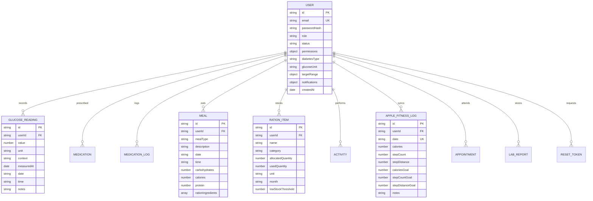

# Software Requirements Specification (SRS)
## GlucoCare — Comprehensive Diabetes & Metabolic Health Management System

**Document Version:** 2.0.0  
**Status:** Approved Architecture Draft  
**Author:** Lead Full-Stack Engineering Team  
**Target Platform:** Next.js 16 (App Router), Node.js v20+, MongoDB Atlas, Vercel Serverless  

---

### Table of Contents
1. [Introduction & Purpose](#1-introduction--purpose)
2. [Target Audience & User Personas](#2-target-audience--user-personas)
3. [System Architecture & Technology Stack](#3-system-architecture--technology-stack)
4. [Functional Requirements (FR)](#4-functional-requirements-fr)
   - [FR-1: Authentication, Authorization & RBAC](#fr-1-authentication-authorization--rbac)
   - [FR-2: Blood Glucose Tracking & Target Range Intelligence](#fr-2-blood-glucose-tracking--target-range-intelligence)
   - [FR-3: Medication Regimens & Dose Adherence Logging](#fr-3-medication-regimens--dose-adherence-logging)
   - [FR-4: Nutrition Diary & Monthly Pantry Ration Engine](#fr-4-nutrition-diary--monthly-pantry-ration-engine)
   - [FR-5: Apple Fitness & Physical Activity Tracking](#fr-5-apple-fitness--physical-activity-tracking)
   - [FR-6: Diagnostic Lab Vault & Printable Clinical Reports](#fr-6-diagnostic-lab-vault--printable-clinical-reports)
   - [FR-7: Appointments, Alarms & Telehealth Scheduler](#fr-7-appointments-alarms--telehealth-scheduler)
   - [FR-8: Multi-Tenant Admin & Clinician Supervision Console](#fr-8-multi-tenant-admin--clinician-supervision-console)
5. [Non-Functional Requirements (NFR)](#5-non-functional-requirements-nfr)
   - [NFR-1: Data Persistence & Zero Data Loss Guarantee](#nfr-1-data-persistence--zero-data-loss-guarantee)
   - [NFR-2: Performance & Serverless Execution Budget](#nfr-2-performance--serverless-execution-budget)
   - [NFR-3: Security, Privacy & Token Management](#nfr-3-security-privacy--token-management)
   - [NFR-4: Accessibility & Multi-Theme Compatibility](#nfr-4-accessibility--multi-theme-compatibility)
6. [Data Dictionary & Entity Relationship Model](#6-data-dictionary--entity-relationship-model)
7. [External Interface Requirements](#7-external-interface-requirements)

---

### 1. Introduction & Purpose

#### 1.1 Objective
GlucoCare is an enterprise-grade metabolic health platform engineered to empower patients living with Type 1, Type 2, and Prediabetes to record, observe, and manage their daily biomarker metrics without cognitive overload. It bridges the gap between daily lifestyle inputs (diet, exercise, medications, pantry supplies) and clinical diagnostics (blood glucose, HbA1c, clinical lab reports).

#### 1.2 Medical Safety Scope & Disclaimer
GlucoCare operates strictly as a personal self-care recording and observational intelligence portal. It does **not** provide autonomous diagnostic assessments or automated insulin dose adjustments. The platform formats clinical summaries to facilitate productive consultations between patients and certified endocrinologists.

---

### 2. Target Audience & User Personas

| Persona | Role | Primary Goals & Workflows | Key Pain Points |
| :--- | :--- | :--- | :--- |
| **Aditya (Working Professional)** | Patient (Primary) | Fast daily logging between office hours; tracks 3 Apple Fitness metrics (Active Calories, Steps, Distance); plans meals from monthly pantry rations. | Data getting wiped on page reload or deployment; complex medical forms. |
| **Dr. Sharma** | Clinician / Doctor | Reviews patient dossiers, observes 14-day TIR (Time In Range) trends, reviews lab vault PDFs, and tracks medication adherence. | Incomplete paper logs; lack of unified multi-patient view. |
| **System Administrator** | Admin | Manages user directory, configures granular feature permissions (RBAC), oversees platform telemetry, and provisions accounts. | Unauthorized privilege escalation; managing isolated patient rights. |

---

### 3. System Architecture & Technology Stack

```
┌────────────────────────────────────────────────────────────────────────┐
│                   Frontend Client (React 19 / Next.js 16)               │
│  - Tailwind CSS v4, Lucide Icons, Recharts, Sonner Toasts, Dark/Light  │
└───────────────────────────────────┬────────────────────────────────────┘
                                    │ HTTPS (JSON + Session Cookie)
┌───────────────────────────────────▼────────────────────────────────────┐
│              Next.js App Router Serverless API Routes (/api/*)         │
│  - Jose JWT Session Validation, Zod Input Sanitization & RBAC Guard    │
└───────────────────────────────────┬────────────────────────────────────┘
                                    │
         ┌──────────────────────────┴──────────────────────────┐
         │                                                     │
┌────────▼─────────────────────────────┐    ┌──────────────────▼─────────────────────┐
│    Primary Data Tier: MongoDB Atlas  │    │     Fallback Tier: Persistent Store    │
│  - Mongoose 8.x ODM Connection Pool  │    │  - Seeded In-Memory State              │
│  - Multi-tenant query isolation      │    │  - Active only if URI unconfigured     │
│  - Indexed collections & schemas     │    └────────────────────────────────────────┘
└──────────────────────────────────────┘
```

- **Runtime Framework**: Next.js 16.3+ (Turbopack, Server-Side Rendering & API Routes)
- **Primary Database**: MongoDB Atlas (MongoDB Server 7.0+ via Mongoose 8.x)
- **Authentication**: Stateless HS256 JWT in `httpOnly` secure cookies via `jose` + `bcryptjs`
- **Email Service**: Nodemailer over authenticated SMTP (supports Gmail, SendGrid, Brevo, Mailtrap)
- **Hosting Target**: Vercel Serverless Platform (Node.js runtime environment)

---

### 4. Functional Requirements (FR)

#### FR-1: Authentication, Authorization & RBAC
- **FR-1.1**: The system shall permit new users to register with name, email, password, diabetes type, and preferred glucose unit (`mg/dL` or `mmol/L`).
- **FR-1.2**: Passwords must be hashed using `bcryptjs` with salt round $\ge 10$ prior to persistence.
- **FR-1.3**: The system shall issue a signed JWT session cookie (`glucocare_session`) upon successful authentication with a 30-day validity window.
- **FR-1.4**: Users registering with a validated `ADMIN_SETUP_KEY` shall be automatically provisioned with the `admin` role and full system permissions.
- **FR-1.5**: The system shall enforce Role-Based Access Control (RBAC) across all protected routes and API endpoints:
  - `patient`: Access restricted strictly to own biomarker logs and profile settings.
  - `doctor`: Read-only or supervised access to assigned patient records and clinical summaries.
  - `admin`: Full administrative governance, user status toggling, and granular permission overrides.
- **FR-1.6**: Password recovery workflow shall generate a cryptographically random token, dispatch an HTML reset email via configured SMTP, and allow single-use token verification.

#### FR-2: Blood Glucose Tracking & Target Range Intelligence
- **FR-2.1**: The system shall allow patients to record blood glucose readings with:
  - Reading Value ($20$ to $600\text{ mg/dL}$)
  - Measurement Unit (`mg/dL` or `mmol/L`)
  - Meal Context (`fasting`, `before_meal`, `after_meal`, `bedtime`, `random`, `other`)
  - Date (`YYYY-MM-DD`) and Time (`HH:mm`)
  - Optional qualitative notes ($\le 300$ chars)
- **FR-2.2**: The system shall evaluate readings against patient-defined target ranges:
  - Normal Fasting: $70 - 130\text{ mg/dL}$
  - Post-Meal Target: $< 180\text{ mg/dL}$
  - Hypoglycemic Alert: $< 70\text{ mg/dL}$
  - Hyperglycemic Alert: $> 180\text{ mg/dL}$
- **FR-2.3**: Interactive Recharts trendline shall plot readings across 7, 14, 30, and 90-day time horizons with visible target boundary bands.

#### FR-3: Medication Regimens & Dose Adherence Logging
- **FR-3.1**: Patients can define active medication courses: name, dosage (e.g. `500 mg`, `10 units`), frequency, administration schedule (`morning`, `afternoon`, `evening`, `bedtime`), and start/end dates.
- **FR-3.2**: Today's Plan checklist shall automatically compile scheduled doses for the current date.
- **FR-3.3**: Patients can log doses with status: `taken`, `skipped`, or `missed`, recording exact execution timestamps.
- **FR-3.4**: Dose logs must synchronize dynamically across Today's Plan checklist and the Medication History diary.

#### FR-4: Nutrition Diary & Monthly Pantry Ration Engine
- **FR-4.1**: Patients can log meals with description, meal type (`breakfast`, `lunch`, `dinner`, `snack`), time, carbohydrates (g), calories (kcal), and protein (g).
- **FR-4.2**: **Monthly Pantry Ration Tracker**:
  - Allows cataloging household staples (e.g., Brown Rice, Whole Oats, Lentils/Moong Dal, Cold-Pressed Oil, Almonds) per month (`YYYY-MM`).
  - Tracks allocated quota vs. used quantity.
  - Automatically flags items falling below user-specified low-stock thresholds.
- **FR-4.3**: **Smart Ration Meal Planner**:
  - Generates diabetologist-recommended recipes adapted to workday vs. weekend routines.
  - Provides a single-click *"Cook & Log Meal"* feature that records the meal in the Food Diary while simultaneously deducting required quantities from the monthly pantry ration stock.

#### FR-5: Apple Fitness & Physical Activity Tracking
- **FR-5.1**: The system shall strictly track the **3 Core Apple Fitness Metrics** per calendar day:
  1. **Active Calories** (kcal) vs. Daily Move Goal (default: $500\text{ kcal}$)
  2. **Step Count** vs. Daily Step Goal (default: $10,000\text{ steps}$)
  3. **Step Distance** (km) vs. Daily Distance Goal (default: $5.0\text{ km}$)
- **FR-5.2**: The system shall render interactive SVG activity rings displaying real-time % completion.
- **FR-5.3**: The system shall maintain historical daily logs allowing navigation to past dates.
- **FR-5.4**: Independent workout activities (e.g., Walking, Running, Cycling, Strength Training, Yoga) with duration and timestamps can be recorded in parallel.

#### FR-6: Diagnostic Lab Vault & Printable Clinical Reports
- **FR-6.1**: **Lab Report Vault**:
  - Securely categorizes clinical records (HbA1c, Lipid Panel, Renal Function, Liver Function, Prescriptions, Doctor Notes).
  - Captures test date, lab/doctor name, summary biomarkers, and associated file metadata.
- **FR-6.2**: **Clinical Summary Generator**:
  - Aggregates glucose readings over selectable ranges (7, 14, 30, 90 days).
  - Calculates Time In Range (% TIR: $70 - 180\text{ mg/dL}$), Hyperglycemia (% $> 180$), Hypoglycemia (% $< 70$).
  - Calculates estimated HbA1c ($eA1c = \frac{\text{Mean Glucose} + 46.7}{28.7}$) and Standard Deviation.
  - Formats a clean printable stylesheet suitable for physical hand-off or PDF generation for clinicians.

#### FR-7: Appointments, Alarms & Telehealth Scheduler
- **FR-7.1**: Allows scheduling doctor consultations with title, doctor name, clinical specialty, date, time, location, and telehealth indicator.
- **FR-7.2**: Allows setting notification alarm reminders: $15\text{m}$, $30\text{m}$, $1\text{h}$, $2\text{h}$, $1\text{d}$ prior to appointment.
- **FR-7.3**: Dashboard displays an upcoming appointment card highlighting days/hours remaining.

#### FR-8: Multi-Tenant Admin & Clinician Supervision Console
- **FR-8.1**: Administrators can browse the complete registered patient directory with active/suspended status indicators.
- **FR-8.2**: Administrators can grant or revoke 11 granular permissions per user (e.g., restricting ration management, meal logging, or reports).
- **FR-8.3**: **Patient Full Dossier View**:
  - Clinicians and administrators can inspect complete historical records for any patient (Glucose readings, Medication logs, Food diary, Apple fitness logs, Lab records) in a unified supervision view.

---

### 5. Non-Functional Requirements (NFR)

#### NFR-1: Data Persistence & Zero Data Loss Guarantee
- **NFR-1.1**: All data must persist in a production-grade external database (MongoDB Atlas).
- **NFR-1.2**: In-memory stores and ephemeral local file operations (`fs.writeFileSync`) must be replaced with robust database operations to prevent data loss on serverless cold starts.
- **NFR-1.3**: Every write mutation (`POST`, `PUT`, `DELETE`) must await atomic database confirmation before responding to the client.

#### NFR-2: Performance & Serverless Execution Budget
- **NFR-2.1**: Mongoose connections must leverage global caching across serverless invocations to eliminate cold-start connection latency.
- **NFR-2.2**: 95% of API requests (`GET /api/glucose`, `POST /api/meals`, etc.) must respond within $\le 350\text{ms}$ under standard broadband connectivity.

#### NFR-3: Security, Privacy & Token Management
- **NFR-3.1**: Session tokens must use cryptographically secure JWT signatures (HS256 with $\ge 256$-bit secret).
- **NFR-3.2**: Cookies must enforce `httpOnly: true`, `sameSite: "lax"`, and `secure: true` in production.
- **NFR-3.3**: Patient data queries must strictly enforce tenant isolation (`userId === session.userId` or `user.role === 'admin'`).

#### NFR-4: Accessibility & Multi-Theme Compatibility
- **NFR-4.1**: The application must offer full Dark Mode and Light Mode support with WCAG AA compliant color contrast ratios ($\ge 4.5:1$).
- **NFR-4.2**: Responsive UI must support iOS Safari, Android Chrome, and Desktop screen sizes ($360\text{px}$ to $2560\text{px}$).

---

### 6. Data Dictionary & Entity Relationship Model



---

### 7. External Interface Requirements

1. **MongoDB Atlas Cluster**:
   - Connection URI: `mongodb+srv://<user>:<password>@<host>/<database>`
   - Security: IP Access List whitelist (`0.0.0.0/0` required for Vercel dynamic IP routing).
2. **SMTP Relay Server**:
   - Port 587 (TLS) or 465 (SSL)
   - Authenticated user credentials for transactional email delivery.
3. **Deployment Host (Vercel)**:
   - Environment variable injection for `MONGODB_URI`, `AUTH_SECRET`, `ADMIN_SETUP_KEY`, and `SMTP_*`.
