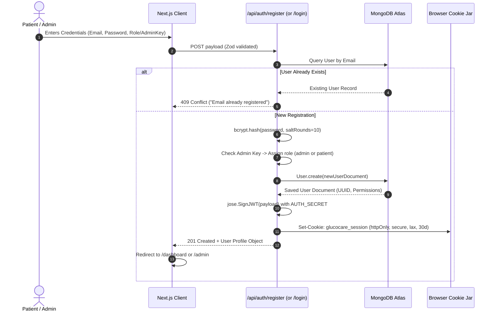
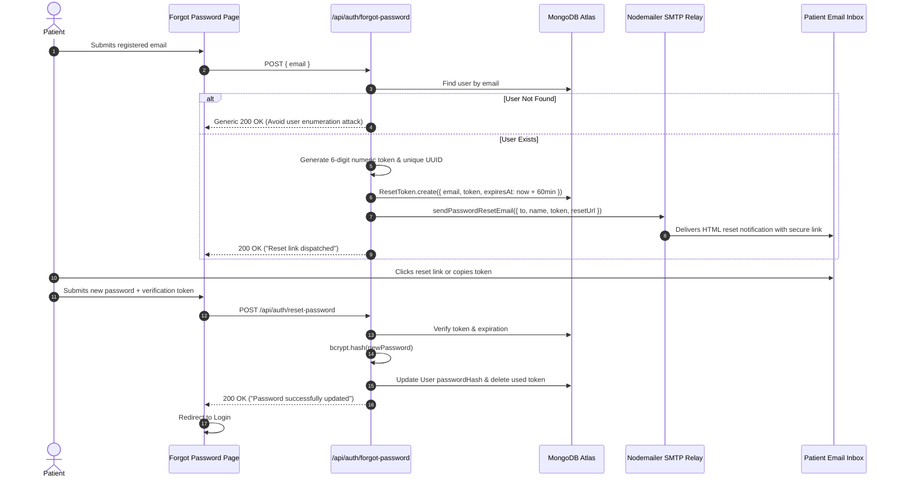
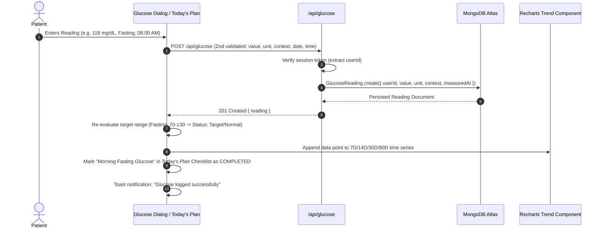
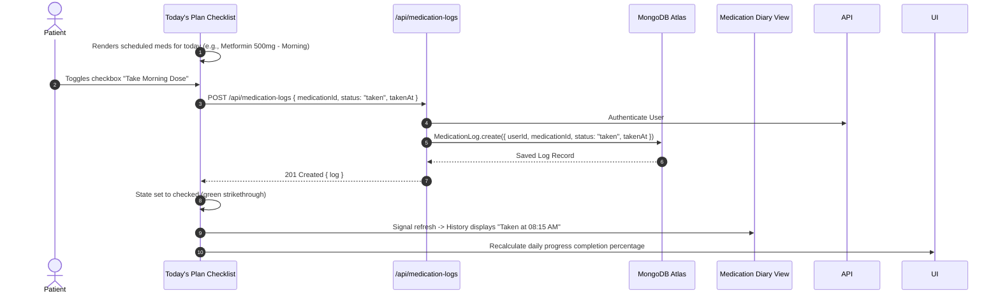
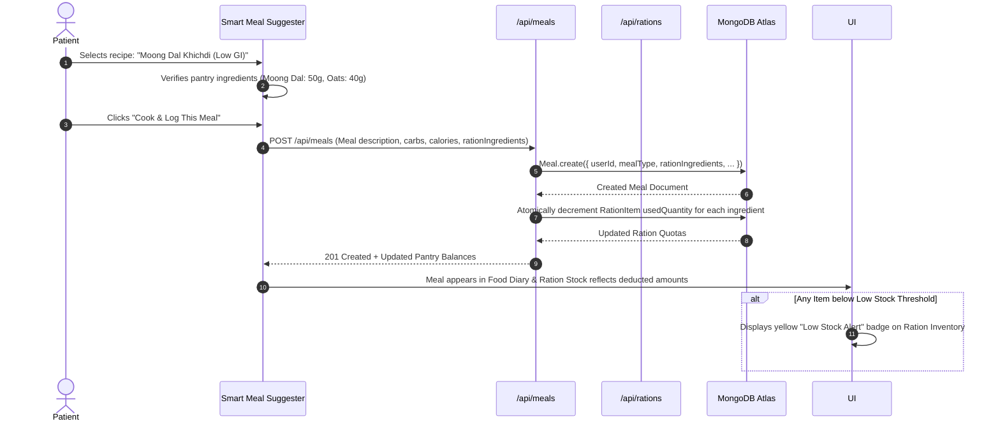
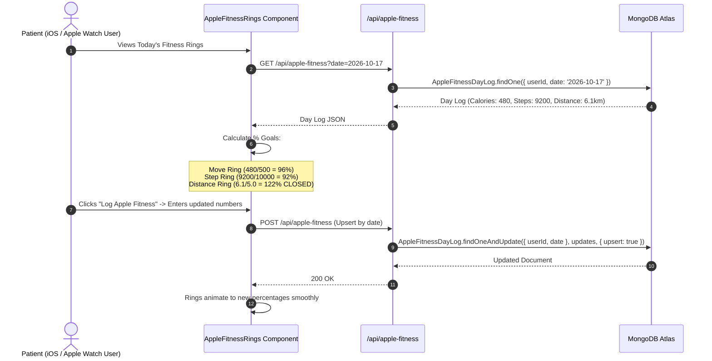
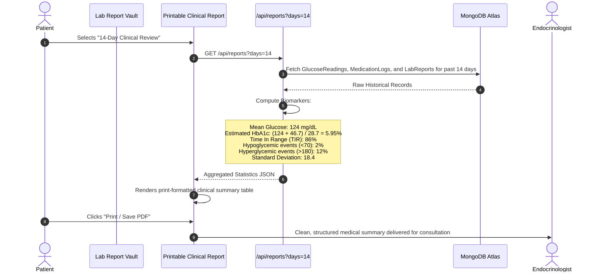
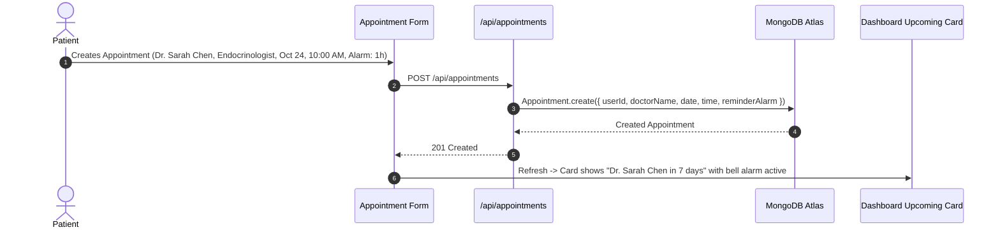
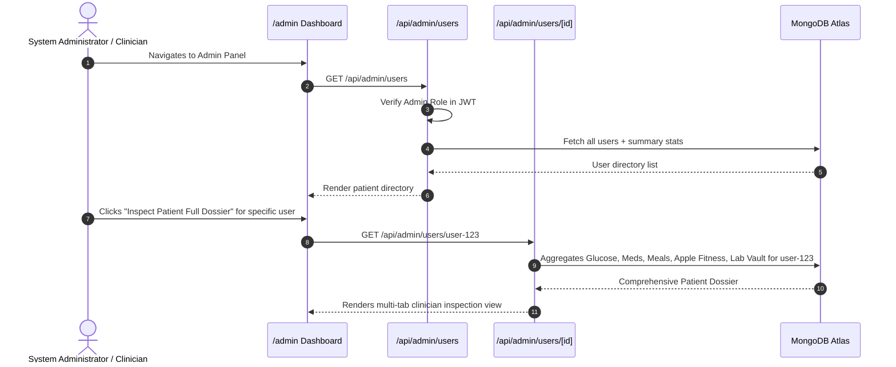
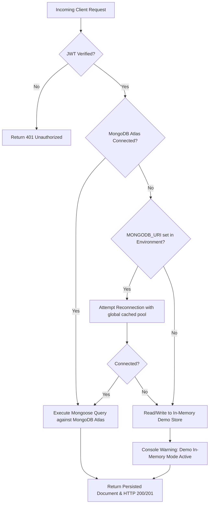

# System Architecture & User Data Flows
## GlucoCare — End-to-End Operational Lifecycle

**Document Version:** 2.0.0  
**Status:** Approved  
**Author:** Lead Full-Stack Engineering Team  

---

### Table of Contents
1. [Flow 1: Authentication & RBAC Session Management](#flow-1-authentication--rbac-session-management)
2. [Flow 2: Secure Password Reset via SMTP Email](#flow-2-secure-password-reset-via-smtp-email)
3. [Flow 3: Blood Glucose Logging & Real-Time Target Evaluation](#flow-3-blood-glucose-logging--real-time-target-evaluation)
4. [Flow 4: Medication Schedule & Today's Plan Checklist Synchronization](#flow-4-medication-schedule--todays-plan-checklist-synchronization)
5. [Flow 5: Nutrition Diary & Monthly Pantry Ration Auto-Deduction Engine](#flow-5-nutrition-diary--monthly-pantry-ration-auto-deduction-engine)
6. [Flow 6: Apple Fitness 3-Metric Daily Tracking & Ring Progress](#flow-6-apple-fitness-3-metric-daily-tracking--ring-progress)
7. [Flow 7: Diagnostic Lab Vault & Printable Clinical Endocrinology Reports](#flow-7-diagnostic-lab-vault--printable-clinical-endocrinology-reports)
8. [Flow 8: Telehealth & Doctor Consultations with Reminder Alarms](#flow-8-telehealth--doctor-consultations-with-reminder-alarms)
9. [Flow 9: Multi-Tenant Administration & Patient Dossier Supervision](#flow-9-multi-tenant-administration--patient-dossier-supervision)
10. [Flow 10: Serverless Data Persistence & Cache Reconciliation Flow](#flow-10-serverless-data-persistence--cache-reconciliation-flow)

---

### Flow 1: Authentication & RBAC Session Management

This flow governs user registration, credential hashing, session token issuance, and role-based route protection.

**Key Architectural Guards:**
- Passwords never stored in plain text.
- Session cookie uses `httpOnly: true` (inaccessible to JavaScript XSS attacks) and `SameSite: Lax` (CSRF prevention).
- If registering with a valid `ADMIN_SETUP_KEY`, role is automatically elevated to `admin` with full system governance permissions.

---

### Flow 2: Secure Password Reset via SMTP Email

Governs self-service password recovery without compromising account security.

---

### Flow 3: Blood Glucose Logging & Real-Time Target Evaluation

Handles recording biomarker readings, calculating hypo/hyperglycemic flags, and updating Recharts trends.

---

### Flow 4: Medication Schedule & Today's Plan Checklist Synchronization

Coordinates prescribed drug schedules, daily dose taking, and checklist synchronization.

---

### Flow 5: Nutrition Diary & Monthly Pantry Ration Auto-Deduction Engine

Integrates food logging with smart monthly pantry inventory management.

---

### Flow 6: Apple Fitness 3-Metric Daily Tracking & Ring Progress

Tracks strictly Active Calories, Step Count, and Step Distance with SVG ring visualization.

---

### Flow 7: Diagnostic Lab Vault & Printable Clinical Endocrinology Reports

Generates clinical reports with calculated metrics for doctor appointments.

---

### Flow 8: Telehealth & Doctor Consultations with Reminder Alarms

---

### Flow 9: Multi-Tenant Administration & Patient Dossier Supervision

---

### Flow 10: Serverless Data Persistence & Cache Reconciliation Flow

